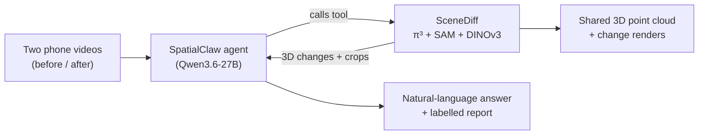
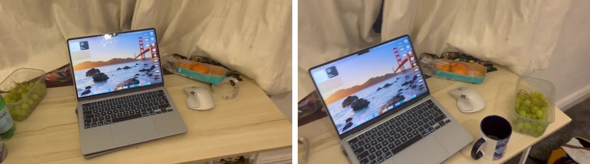
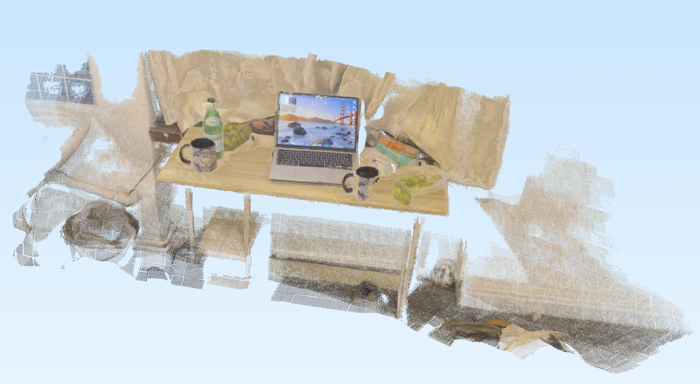
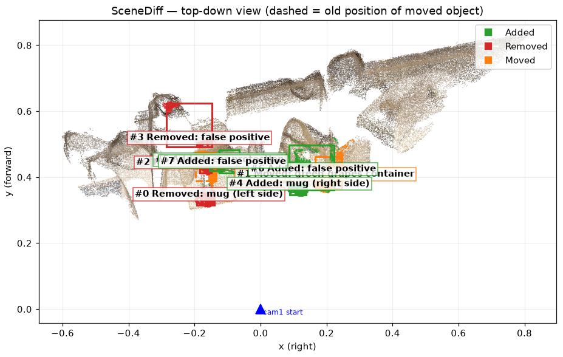
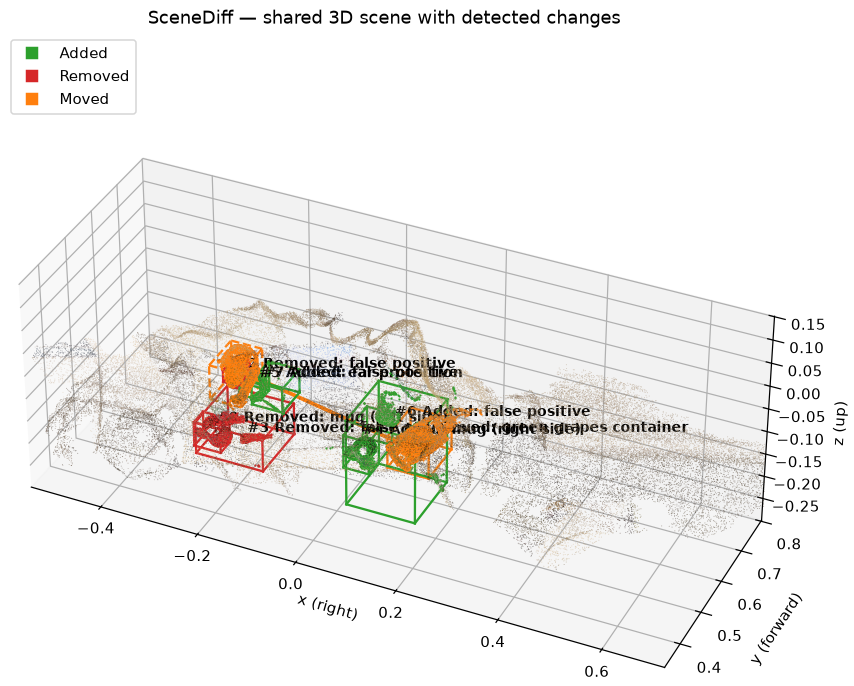
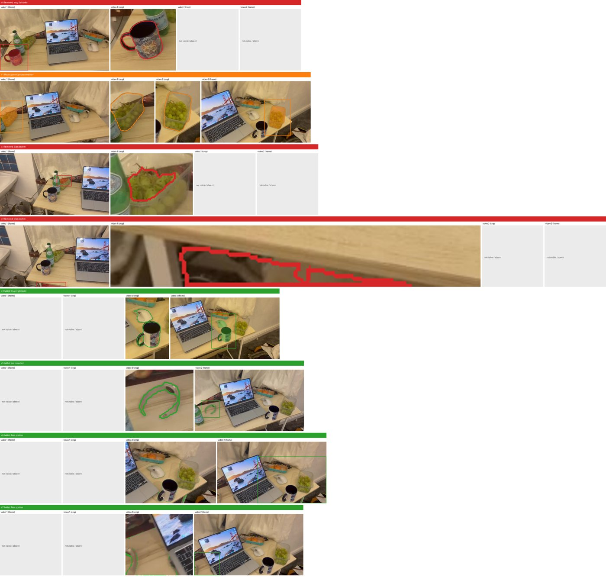

# What Changed in the Room? — SceneDiff × SpatialClaw

## Introduction

This project uses an agentic AI system to identify and explain changes in indoor spaces over time. It takes **two phone recordings of the same room and a text question** as input—for example, “What changed in the room?”

The agent uses perception tools to gather visual evidence from both recordings, then reasons over **2D observations and 3D change detections together** to determine what changed and where. By combining these complementary sources of evidence, it can distinguish meaningful changes—such as moved furniture, added obstacles, or removed objects—from differences in viewpoint, occlusion, and incomplete observations.

The agent framework is built on [SpatialClaw](https://spatialclaw.github.io/), extended with [SceneDiff](https://github.com/yuqunw/scene_diff) as an additional perception tool for 3D change detection. SceneDiff locates potential changes in a shared 3D representation, while the main agent interprets and cross-checks the evidence to produce a natural-language answer. The original SpatialClaw README is in [SPATIALCLAW_README.md](SPATIALCLAW_README.md).

## Design Choice

This project builds on the motivation behind my previous work, [TAU-Agent](https://github.com/siri-rouser/TAU-Agent), which used an agentic system to solve spatial reasoning problems using only 2D information. Extending this approach to 3D is a direction I want to explore in future research, so I chose an agentic architecture for this task.

Rather than adapting TAU-Agent directly, I chose **SpatialClaw as the foundation** because it already provides 3D perception tools and an agent that can write and run Python to use them. However, in my tests, the agent tended to rely on 2D observations even when 3D information was available, and the existing workflow did not reconstruct both recordings into a shared 3D representation. This motivated adding **SceneDiff as a SpatialClaw tool**, giving the agent explicit change detections grounded in a common 3D space.

The two components play complementary roles:

- **SceneDiff finds *where* things changed.** It jointly reconstructs both videos into one shared 3D space with [π³](https://github.com/yyfz/Pi3), then combines geometric differences, SAM segmentation and DINOv3 features to detect added, removed and moved objects.
- **The SpatialClaw agent works out *what* changed.** It inspects SceneDiff's detections, names the objects, discards false positives, cross-checks the original frames, and writes the final answer.

**Trade-off: accuracy versus latency.** In my tests, combining SceneDiff with the agent produced more accurate results than SceneDiff alone. However, the end-to-end workflow took more than five minutes on a server with three NVIDIA A40 GPUs. The current system therefore prioritizes evidence-based analysis over real-time performance; reducing latency remains an important limitation to address.

## Architecture



The agent calls `tools.SceneDiff.Compare(1, 2)` from its Python sandbox. SceneDiff runs on a GPU tool server and saves the point clouds and renders. The agent then reviews each detection, saves its labels with `tools.SceneDiff.Annotate(...)`, and returns the answer.

## Example

**Input:** two phone videos of a desk from different viewpoints, [video1_indoor.mp4](video_data/video1_indoor.mp4) (before) and [video2_indoor.mp4](video_data/video2_indoor.mp4) (after).

<p align="center"></p>

**Question:** *"Find the difference between video1 and video 2. The reasoning process should include the scene_diff tool and save all intermediate results generated by scene_diff should also be saved."*

The complete output of this run (point clouds, renders, agent trace and HTML report) is in **[example_output/](example_output/)**.

### Shared 3D representation

Both recordings fused into one point cloud (`scene_shared.ply`). Both the old and new positions of the mug and the grapes container are visible.

<p align="center"></p>

### Detected changes

Green = added, red = removed, orange = moved (dashed box = old position).

| Top-down view | 3D view |
|---|---|
|  |  |

<details>
<summary>Per-object crops the agent inspected</summary>
<p align="center"></p>
</details>

### SceneDiff detections vs. the final answer

SceneDiff's raw detections (`changes.json`) are **not all correct**:
- 4 of the 8 detections are false positives: partial duplicates, a region under the table, and the laptop screen.
- The moved mug is split into a separate "Removed" and "Added".
- A small wooden fork is missed.

**SpatialClaw's final answer is correct.** The agent discarded the false positives, merged the mug detections into one move, and found the fork by checking the frames itself:

> 1. **Mug moved** (video1 frame 72 → video2 frame 144): The skull-design mug was on the LEFT side of the table next to the green bottle in video1, but moved to the RIGHT side of the table in video2. SceneDiff detected this as #0 (Removed from left) and #4 (Added on right).
> 2. **Green grapes container moved** (video1 frame 96 → video2 frame 120): The clear container of green grapes was positioned near the center of the table (next to the bottle) in video1, and moved to the RIGHT side of the table in video2. SceneDiff correctly detected this as #1 (Moved, displacement ~0.35m).
> 3. **Ear protection added** (visible in video2 frame 72+): A pair of clear plastic ear protection was placed on the table next to the green bottle in video2. This object was absent in video1. SceneDiff detected this as #5 (Added).
> 4. **Wooden fork added** (visible in video2 frame 0+): A small wooden fork/spatula was placed on the table next to the bottle in video2. This was NOT detected by SceneDiff due to its small size.
>
> All other objects (laptop, mouse, orange container, green bottle, apple bag) remained in the same positions across both videos.

<sub>π³'s reconstruction is up-to-scale, so "0.35m" here means 0.35 scene units.</sub>

## How to Run

See **[HOW_TO_RUN.md](HOW_TO_RUN.md)** for setup, starting the three services (VLM, GPU tool server, agent), and where outputs are saved.

## Acknowledgements and Licenses

Built on [SpatialClaw](https://github.com/NVlabs/SpatialClaw) (© 2026 NVIDIA, NVIDIA Source Code License-NC; see [LICENSE](LICENSE), which this repository inherits) and [SceneDiff](https://github.com/yuqunw/scene_diff) (MIT). It also uses [π³](https://github.com/yyfz/Pi3), [Segment Anything](https://github.com/facebookresearch/segment-anything) and [DINOv3](https://github.com/facebookresearch/dinov3), each under its own license in `tools/third_party/`.

```bibtex
@article{cho2026spatialclaw,
  title   = {SpatialClaw: Rethinking Action Interface for Agentic Spatial Reasoning},
  author  = {Cho, Seokju and Hachiuma, Ryo and Badki, Abhishek and
             Su, Hang and Lee, Byung-Kwan and Song, Chan Hee and
             Liu, Sifei and Radhakrishnan, Subhashree and Kim, Seungryong and
             Wang, Yu-Chiang Frank and Chen, Min-Hung},
  journal = {arXiv preprint},
  year    = {2026}
}

@article{wu2025scenediff,
  title   = {SceneDiff: A Benchmark and Method for Multiview Object Change Detection},
  author  = {Wu, Yuqun and Lin, Chih-hao and Che, Henry and Tiwari, Aditi and
             Zou, Chuhang and Wang, Shenlong and Hoiem, Derek},
  journal = {arXiv preprint arXiv:2512.16908},
  year    = {2025}
}
```
