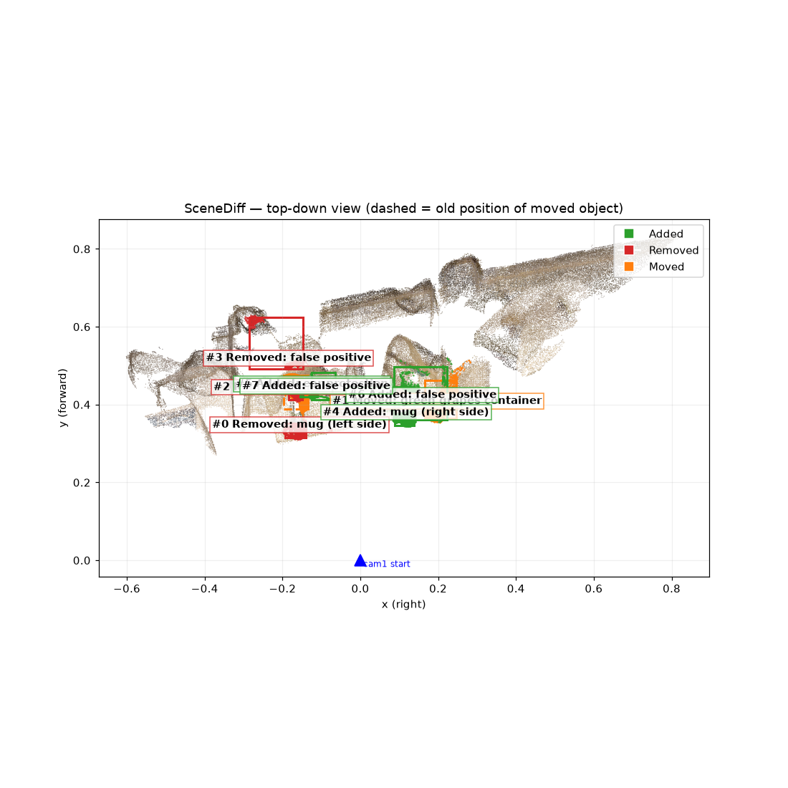
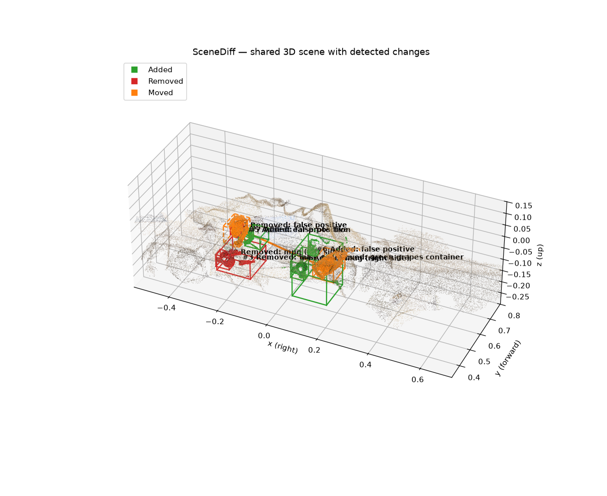
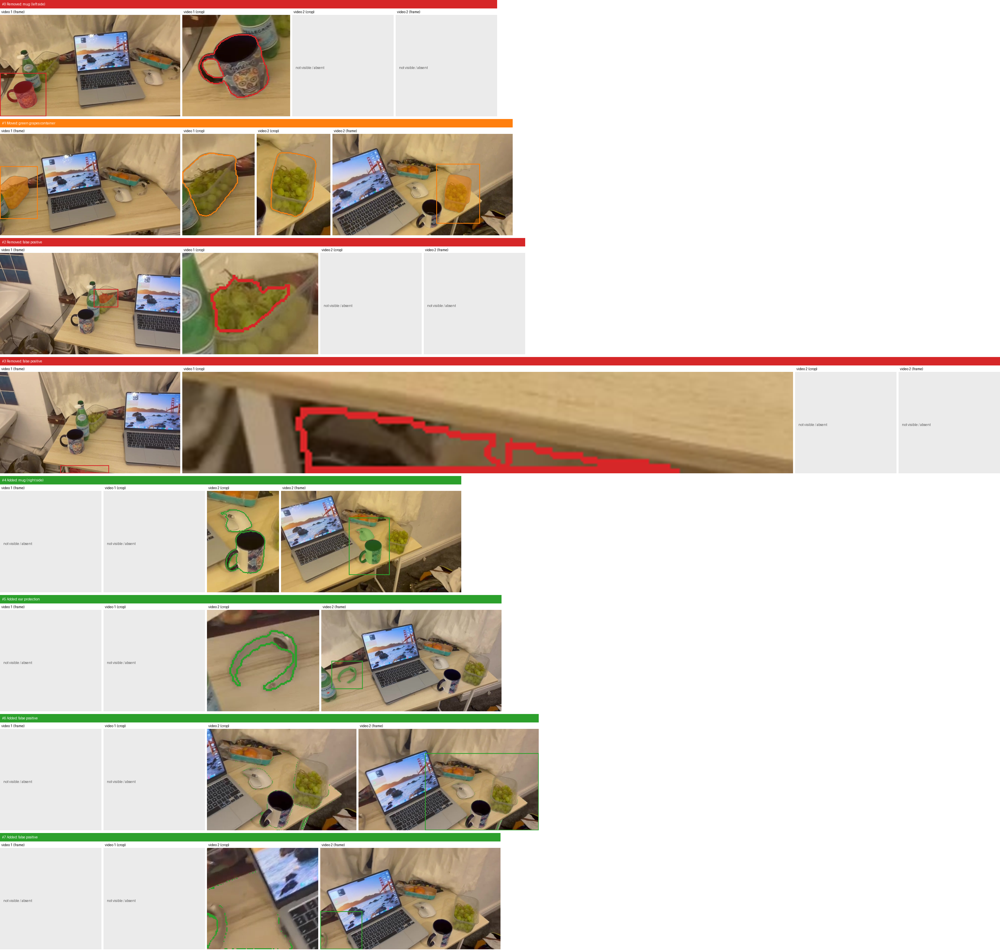

# SceneDiff change report

- Video 1 (before): `/workspace/SpatialClaw/video_data/video1_indoor.mp4`
- Video 2 (after): `/workspace/SpatialClaw/video_data/video2_indoor.mp4`
- Frames used: [8, 9]
- Scene extent (robust diameter): 1.10 scene units. Coordinates are gravity-aligned (x right, y forward, z up) relative to video 1's first camera; the reconstruction is up-to-scale, so distances are reported in scene units and as a % of the scene extent.

## Summary

Key differences between video1 and video2:
1. Mug moved: The skull-design mug was on the LEFT side of the table in video1, moved to the RIGHT side in video2.
2. Grapes container moved: The clear container of green grapes was near the center (next to the bottle) in video1, moved to the RIGHT side in video2.
3. Ear protection added: A pair of clear plastic ear protection was placed on the table next to the bottle in video2.
4. Wooden fork added: A small wooden fork/spatula was placed next to the bottle in video2 (not detected by SceneDiff due to small size).

## Changes

| id | change | label | position (before) | position (after) | moved by | description |
|---|---|---|---|---|---|---|
| 0 | Removed | mug (left side) | (-0.16, +0.33, -0.06) | — |  | Mug with skull design was on the left side of the table in video1, removed/moved to right side in video2 |
| 1 | Moved | green grapes container | (-0.15, +0.44, +0.00) | (+0.20, +0.40, -0.03) | 0.35 (32% of scene) | Container of green grapes moved from center of table (near bottle) to right side of table |
| 2 | Removed | false positive | (-0.17, +0.43, +0.00) | — |  | Partial detection of grapes container, duplicate of #1 |
| 3 | Removed | false positive | (-0.18, +0.51, -0.19) | — |  | Detection under table edge, not a real object change |
| 4 | Added | mug (right side) | — | (+0.12, +0.37, -0.04) |  | Same mug now on right side of table in video2 (moved from left) |
| 5 | Added | ear protection | — | (-0.12, +0.44, -0.01) |  | Clear plastic ear protection added on table next to the bottle in video2 |
| 6 | Added | false positive | — | (+0.16, +0.41, -0.04) |  | Partial detection of right side area with grapes/mouse, duplicate of #1 |
| 7 | Added | false positive | — | (-0.11, +0.43, -0.02) |  | Detection on laptop screen area, not a real object change |

## Files

- **changes_highlight**: `changes_highlight.ply`
- **changes_json**: `changes.json`
- **raw_cost_map_1**: `scenediff_raw/cost_map_1.ply`
- **raw_cost_map_2**: `scenediff_raw/cost_map_2.ply`
- **raw_cost_map_merged**: `scenediff_raw/cost_map_merged.ply`
- **raw_object_instances_1**: `scenediff_raw/object_instances_1.ply`
- **raw_object_instances_2**: `scenediff_raw/object_instances_2.ply`
- **raw_object_masks**: `scenediff_raw/object_masks.pkl`
- **render_crops**: `render_crops.png`
- **render_oblique**: `render_oblique.png`
- **render_topdown**: `render_topdown.png`
- **report**: `report.md`
- **scene_shared**: `scene_shared.ply`
- **scene_video1**: `scene_video1.ply`
- **scene_video2**: `scene_video2.ply`
- **scene_vis**: `scene_vis.npz`

